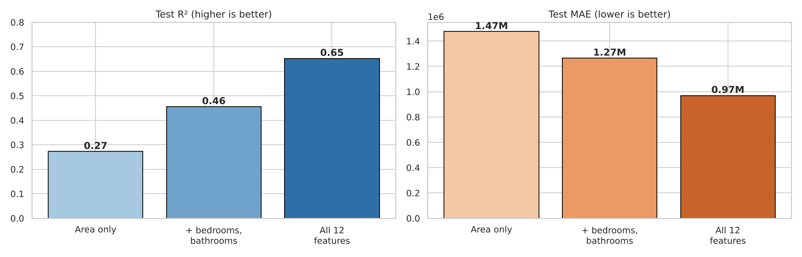
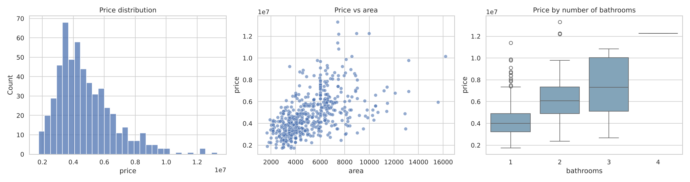
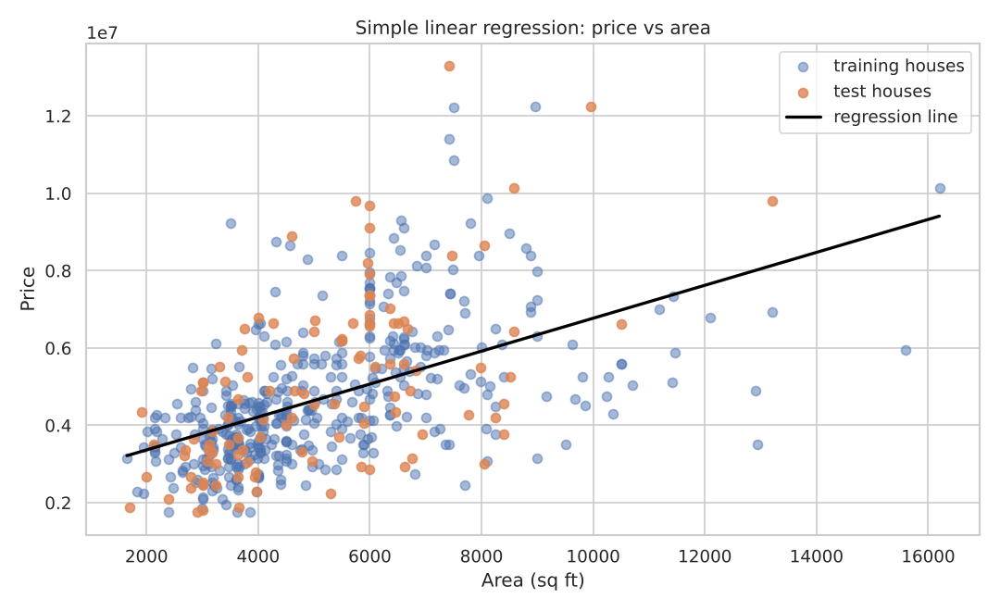
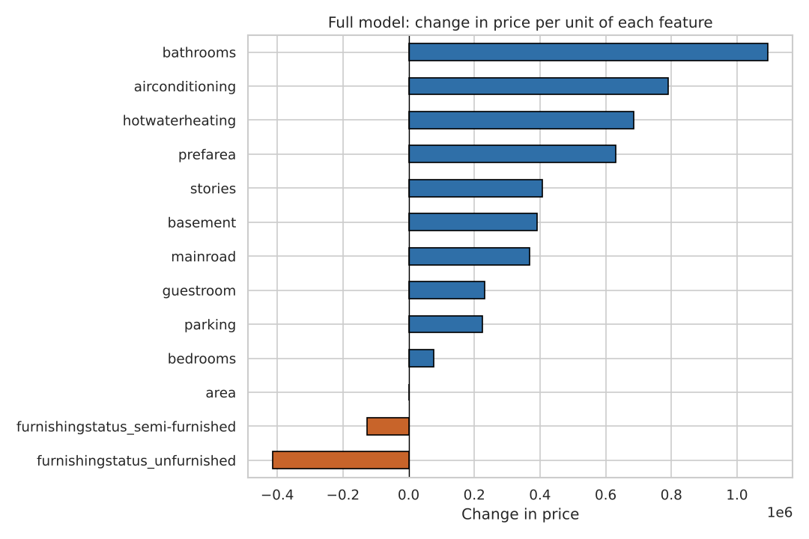
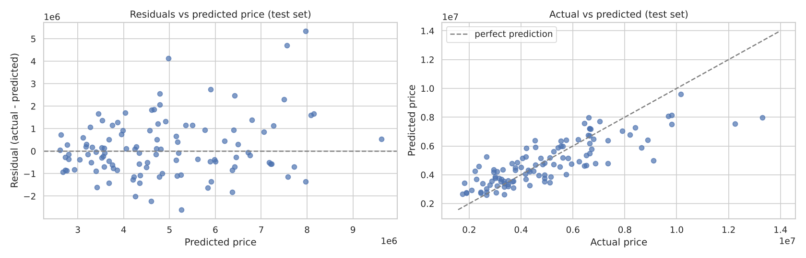

# House Price Prediction with Linear Regression

How much does each feature add to a house's price? This project builds three linear regression models, from area alone up to all 12 features, and measures on houses the models have never seen how much each step improves the predictions.




## Results

| Model | Features | Test R² | 5-fold CV R² | Test MAE |
|---|---|---|---|---|
| Simple | area | 0.27 | 0.23 | 1.47M |
| Multiple | area, bedrooms, bathrooms | 0.46 | 0.43 | 1.27M |
| **Full** | **all 12 features** | **0.65** | **0.63** | **0.97M** |

Going from area alone to the full feature set **more than doubles the price variation explained (27% → 65%)** and cuts the typical prediction error by about a third.

## Overview

The [Housing Prices Dataset](https://www.kaggle.com/datasets/yasserh/housing-prices-dataset) from Kaggle describes 545 houses: price, area, bedrooms, bathrooms, stories, parking, five amenities, whether the house is in a preferred area, and its furnishing status.

It started as a linear regression practice lab during my data science training (2024). I later revisited it and:
- **evaluated every model on held-out test data.** The original scored each model on the same houses it was trained on, which overstates performance;
- **encoded all categorical columns properly** (yes/no → 1/0, one-hot encoding for furnishing status) instead of dropping some of them;
- added a **coefficient interpretation**, a **residual analysis**, a **saved model** and **command-line scripts**.

## Walkthrough

The full analysis is in [`notebooks/house_price_prediction.ipynb`](notebooks/house_price_prediction.ipynb).

### 1. Explore and prepare
The data is clean, with no missing values or duplicates. Seven text columns are encoded for the model. Furnishing status uses one-hot encoding because it has no natural order.



### 2. Start simple
A single-feature model: each extra square foot adds about 430 to the price, but area explains only about 27% of the variation. Houses of the same size sell for very different prices.



### 3. Add features step by step
Adding bedrooms and bathrooms raises the test R² to 0.46. Adding stories, parking, amenities, location and furnishing raises it to 0.65. Train and test scores stay close at every step, so the models aren't overfitting.

### 4. Interpret what drives price
Holding everything else constant, the full model estimates:



| Feature | Effect on price |
|---|---|
| Each extra bathroom | about +1.09M |
| Air conditioning | about +790K |
| Hot water heating | about +680K |
| Preferred area | about +630K |
| Each extra story | about +410K |
| Unfurnished (vs furnished) | about −410K |

Bedrooms add only about 77K once bathrooms and area are included, because bigger houses tend to have more of both, and bathrooms carry most of that information.

### 5. Check where the model struggles
The residuals are balanced for typical houses but **spread out for expensive ones**, and the most expensive houses tend to be under-predicted. That is a common limit of linear models on skewed prices.



### Next steps
- Model log(price) to handle the skew in prices
- Try non-linear models (for example, gradient boosting) to capture interactions
- Add location-level data

## Project structure

```
house-price-prediction/
├── data/
│   ├── housing.csv               # 545 houses
│   └── README.md                 # column descriptions
├── figures/                      # charts produced by the notebook
├── models/
│   └── house_price_model.joblib  # trained full model
├── notebooks/
│   └── house_price_prediction.ipynb   # step-by-step walkthrough
├── src/
│   ├── features.py               # shared loading and encoding
│   ├── train.py                  # compare the models, train and save the full model
│   └── predict.py                # command-line predictions
├── requirements.txt
└── README.md
```

## Getting started

```bash
git clone https://github.com/FaithNjah/house-price-prediction.git
cd house-price-prediction
pip install -r requirements.txt
```

**Predict a price:**
```bash
python src/predict.py --area 6000 --bedrooms 3 --bathrooms 2 --stories 2 \
    --parking 1 --mainroad --airconditioning --furnishing semi-furnished
# Predicted price: 6,245,996
```
Amenities are flags: add `--guestroom`, `--basement`, `--hotwaterheating` or `--prefarea` if the house has them.

**Retrain and compare the models:**
```bash
python src/train.py
```

**Explore the walkthrough:**
```bash
jupyter notebook notebooks/house_price_prediction.ipynb
```

## Skills demonstrated

- Simple and multiple linear regression with **scikit-learn**
- Train/test splitting and k-fold cross-validation
- Encoding binary and nominal categorical variables
- Comparing models fairly with R², MAE and RMSE
- Interpreting coefficients ("holding everything else constant")
- Residual analysis to find a model's weak spots
- Saving models and building a command-line prediction tool

## Author

**Faith Njah**

More projects: [Salary Prediction](https://github.com/FaithNjah/salary-prediction-linear-regression) · [Titanic Data Cleaning](https://github.com/FaithNjah/titanic-data-cleaning) · [Medical Students Data Preprocessing](https://github.com/FaithNjah/medical-students-data-preprocessing)
